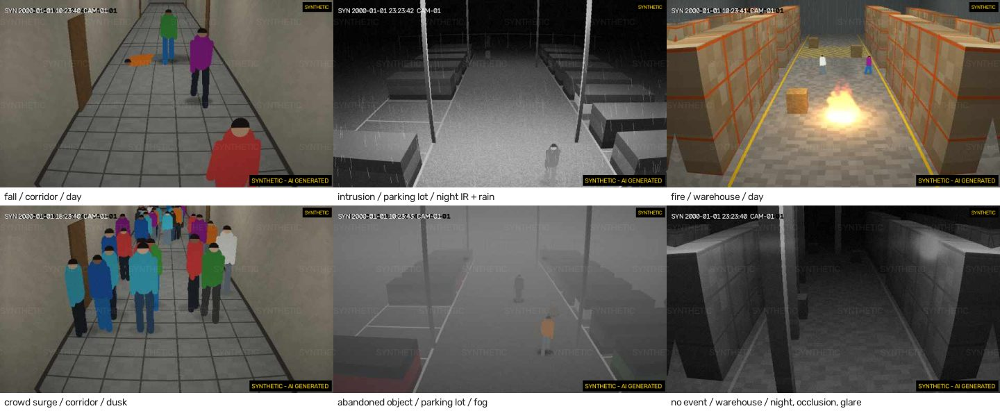

# CCTVGPT: footage search and synthetic CCTV for Indian public safety

CCTVGPT has two parts that work together:

1. **Forensic footage search** ([docs/SEARCH.md](docs/SEARCH.md)). Find specific people, vehicles, objects and moments across photo galleries, video files and CCTV/NVR exports, including dark, noisy and IR night footage. Search by plain-language description or by example photo, then export segments from the untouched original with a chain-of-custody record. It runs on-premises on CPU, every search is tied to a case reference and audited, and there is no face recognition.
2. **Synthetic CCTV generation with safeguards** (below). This is the test bench that measures search and analytics accuracy under night, rain, fog and occlusion with exact ground truth, and the data engine for making search robust.

The generator was built first, from the original PRD (*Synthetic CCTV-Style Video Generation*, draft v0.1): prompt-based generation of realistic, fixed-camera, CCTV-style clips for training and testing video-analytics systems, with safeguards built into the core of the product. This is the Phase 1 build of the VidyuthLabs AI vertical described in *PRD: Synthetic CCTV-Style Video Generation* (draft v0.1, 6 November 2026).

**Every output is synthetic, visibly labelled, invisibly watermarked and signed. Nothing here may be used or presented as evidence or as a record of real events.**



## What it does

* **Text prompt to clip.** A prompt such as *"a person slips and falls in a dimly lit corridor at night"* maps onto a closed set of controls. The controls are scene, event, time of day, weather, camera height/tilt/pan/FOV, resolution, frame rate and duration, and explicit parameters override the prompt. The response reports what was understood, which words were ignored and any conflicts.
* **Event library:** fall, intrusion into a restricted zone, fire (flame, smoke and light), crowd surge, abandoned object, or no event, in three scenes (corridor, parking lot, warehouse). Also **hard-negative "confuser" events** (walk-through, crouch, deliberate lie-down), annotated `alarm: false`, which cause most false alarms in real deployments. `event_distance_m` stages an event at a chosen distance from the camera.
* **CCTV realism:** auto-exposure, IR night mode with illuminator falloff, barrel lens distortion, bloom and glare, vignetting, sensor noise scaled to light level, JPEG/H.264 compression artifacts, resolution loss, and an on-screen timestamp marked `SYN` that uses a fixed simulation epoch (year 2000).
* **Exact ground truth:** per-frame boxes (corrected for lens distortion), track IDs, visibility under occlusion, actor states (walking / falling / fallen / running), event start and end frames, and restricted-zone polygons, exported as JSON plus MOT-style CSV.
* **Reproducible:** the same parameters and seed give bit-identical frames for a given renderer version, which is recorded in every manifest.
* **Safeguards:** visible label, robust invisible watermark, Ed25519-signed provenance embedded in the MP4, a public verification page, KYC-gated access, prompt filtering, a hash-chained audit log, terms of use, a misuse-reporting channel, a contract-gated clean-export exception, and a release gate owned by the safeguards owner.
* **Acceptance testing:** submit a detector's outputs for a generated batch and get a scorecard: precision, recall and AP, broken down by condition, object size and actor state, plus event detection rate, latency and false alarms (`cctvgpt/evaluation.py`, `POST /v1/batches/{id}/evaluate`, `cctvgpt evaluate`).
* **Interfaces:** web dashboard, REST API (single clips, parameter-sweep batches, zip export) and an operator CLI.

### Technical approach

The PRD (section 8) leaves the choice between a text-to-video foundation model (Option A) and a simulation-plus-AI hybrid (Option B) open until a feasibility test. This build implements **Option B's simulation core** as the default backend:

* a ray-cast 3D scene with a fixed pinhole camera
* depth-tested, faceless articulated figures
* scripted events

This gives a stable view (FR-8) and exact annotations (FR-7) by construction, and it cannot depict real, identifiable people.

`cctvgpt/backends` defines the adapter interface that an Option A model or an AI realism pass would plug into. Every safeguard is applied by the pipeline whatever the backend. Model choice, licences and compute remain **[OPEN]** for the technical lead (see [docs/OPEN_ITEMS.md](docs/OPEN_ITEMS.md)).

## Quick start

Requires Python 3.10+ and `ffmpeg`/`ffprobe` on `PATH`.

```bash
pip install -e '.[dev]'
```

Create keys and the first admin and safeguards-owner API keys (each key is printed once):

```bash
cctvgpt init --admin "Platform Admin" --owner "Safeguards Owner"
```

The safeguards owner runs the self-test and approves the renderer (SR-10). Nothing can be generated before this:

```bash
cctvgpt release approve --owner "Safeguards Owner" --notes "Phase 1 feasibility"
```

Onboard a business customer: create the record, record verified KYC, then issue an API key. The customer accepts the terms of use from the dashboard.

```bash
cctvgpt customer create --name "Acme Vision" --org-type video_analytics --email ops@acme.example
```

```bash
cctvgpt customer kyc --id cus_... --status verified --reference GSTIN-...
```

```bash
cctvgpt customer key --id cus_... --principal alice
```

Run the dashboard and API on http://127.0.0.1:8000. The public verification page is at `/verify`.

```bash
cctvgpt serve
```

Or generate from the command line:

```bash
cctvgpt customer terms --id cus_...
```

```bash
cctvgpt generate --customer cus_... --prompt "intrusion into the restricted zone of a parking lot at night, rain" --set scene.seed=4 --out out/demo
```

Verify any file:

```bash
cctvgpt verify out/demo/clip_....mp4
```

Data (SQLite database, keys, clips) lives in `./data`, or wherever `CCTVGPT_DATA_DIR` points. Settings are listed in `cctvgpt/config.py`.

## API summary

| Endpoint | Who | Purpose |
|---|---|---|
| `GET /`, `GET /verify` | anyone | Dashboard; public verification and misuse-report page |
| `POST /v1/verify` | anyone | Upload a clip and get a provenance verdict (SR-4) |
| `POST /v1/misuse-reports` | anyone | Report misuse (SR-8) |
| `GET /v1/public-key`, `GET /v1/terms`, `GET /v1/options` | anyone | Verification keys, terms of use, parameter schema |
| `POST /v1/interpret` | customer | Preview prompt interpretation and filter result |
| `POST /v1/generate[?wait=true]` | customer | Queue or run one clip |
| `POST /v1/batches` | customer | Parameter sweep, e.g. `{"sweep": {"weather": ["clear","rain"], "seed": [1,2,3]}}` |
| `GET /v1/jobs`, `/v1/jobs/{id}`, `/v1/batches/{id}[/export.zip]` | customer | Status and downloads |
| `POST /v1/batches/{id}/evaluate[?format=html]` | customer | Acceptance test: score detector outputs against the batch's ground truth |
| `GET /v1/clips/{id}/video` and `/annotations`, `/tracks`, `/provenance` | owning customer | Outputs |
| `/v1/admin/...` | admin | Customers, KYC, API keys, audit log and chain check, misuse reports, full verification |
| `POST /v1/releases/selftest`, `POST /v1/releases/decide` | safeguards owner | Release gate (SR-10) |

Authentication uses the `X-API-Key` header. There is no anonymous generation.

## PRD traceability

| ID | Requirement | Implementation |
|---|---|---|
| FR-1 | Text prompt to fixed-camera clip, configurable length | `prompt.py`, `pipeline.py`; `duration_s` 1–30 s (cap via `CCTVGPT_MAX_DURATION_S`) |
| FR-2 | Scene, time, weather, camera, resolution, fps controls | `params.py`, `render/camera.py`, `render/scenes.py` |
| FR-3 | Low-res, compression, IR, distortion, timestamp overlay | `realism.py` |
| FR-4 | Event library | `render/events.py` (`EVENT_BUILDERS`) |
| FR-5 | Reproducibility, versioned model tracking | Seeded RNG per purpose; `RENDERER_VERSION`, `params_sha256` in manifest; test `test_same_seed_is_bit_identical` |
| FR-6 | Batch generation, dashboard and API | `jobs.py` (queue, sweeps, zip), `api/` |
| FR-7 | Ground-truth annotations | `*.annotations.json`, `*.tracks.csv` |
| FR-8 | Stable background and camera view | Fixed camera, static background rendered once, exposure fixed per clip; `fixed_view_stability` QA metric |
| SR-1 | Persistent visible "SYNTHETIC" marking | `safeguards/label.py` (two corner badges plus a tiled pattern); checked on every frame before release |
| SR-2 | Robust invisible watermark | `safeguards/watermark.py`; results below and in [docs/SAFEGUARDS.md](docs/SAFEGUARDS.md) |
| SR-3 | Signed provenance metadata | `safeguards/provenance.py`: Ed25519, C2PA-aligned fields, embedded in MP4 and sidecar; includes the platform unique identifier (`platform_uid`) required by the IT Rules 2026 |
| SR-4 | Public verification page | `verify.py`, `/verify`, `POST /v1/verify` |
| SR-5 | Business KYC, no anonymous access | `store.py` customers/API keys; `pipeline.check_customer` |
| SR-6 | Prompt and output filtering | `safeguards/content_filter.py` (prompts); closed vocabulary; release QA gate on outputs |
| SR-7 | Audit logs | Hash-chained `audit` table; `cctvgpt audit verify`; retention via `CCTVGPT_AUDIT_RETENTION_DAYS` **[OPEN]** |
| SR-8 | Terms of use and misuse channel | [docs/TERMS_OF_USE.md](docs/TERMS_OF_USE.md), [docs/MISUSE_POLICY.md](docs/MISUSE_POLICY.md), `POST /v1/misuse-reports` |
| SR-9 | Clean-export exception | Off by default (`CCTVGPT_CLEAN_EXPORT_ENABLED`); also needs an enterprise contract and a `feature/clean_export` approval; watermark, metadata and logging retained. **Likely conflicts with the IT Rules 2026 duty to prevent label removal; recommended for withdrawal in India** ([docs/COMPLIANCE.md](docs/COMPLIANCE.md)) |
| SR-10 | Release gate | `release_gate.py`: approval requires a passing safeguards self-test; generation refuses unapproved versions |

## Search quickstart

Install the search models (CPU builds of PyTorch work):

```bash
pip install -e '.[search]'
```

Index a case folder and search it:

```bash
cctvgpt search ingest /evidence/FIR-0123 --case FIR-0123/2026 --camera "Gate 2" --officer "SI Sharma"
```

```bash
cctvgpt search query "a person lying on the floor" --case FIR-0123/2026 --purpose "locate fall incident" --officer "SI Sharma"
```

Or run `cctvgpt serve` and open `/search` with an investigator key. Measured accuracy on real and synthetic footage is in [docs/SEARCH.md](docs/SEARCH.md).

## Evidence on real data

`benchmarks/` tests the product against real footage and published research. See [benchmarks/README.md](benchmarks/README.md) for the protocol, results and limits:

* `fall_sim2real.py`: does synthetic data help detect *real* falls? Uses the UR Fall Detection Dataset (internal evaluation only, CC BY-NC-SA).
* `stress_test_detector.py`: an off-the-shelf COCO person detector, scored across conditions on a CCTVGPT suite. This demonstrates acceptance testing and probes realism.
* `search_eval.py`: footage-search accuracy on real URFD frames (day vs simulated night, English vs Hindi) and clothing-colour search on synthetic day/night/IR/rain/fog footage.

Strategy and compliance are covered in [docs/STRATEGY.md](docs/STRATEGY.md) and [docs/COMPLIANCE.md](docs/COMPLIANCE.md). The latter includes the February 2026 IT Rules SGI amendment, the DPDP Rules 2025 and EU AI Act Article 50.

## Measured results (this build)

These are automated measurements from this repository, not benchmarks. Practitioner acceptance (PRD section 9) still needs human review.

* **Watermark** (`scripts/eval_watermark.py`, 6 clips across all scenes, 6 s each):
  * Mean PSNR is 40.7 dB.
  * No false positives on unmarked clips.
  * Detection is 100% after platform encode, CRF 28 re-encode, 75% resize, half frame rate, MPEG-4 transcode, brightness/contrast change, grayscale, and trimming the first second.
  * Detection drops to 83% at CRF 35 and at 50% resize + CRF 28, and to 50% at 50% resize + CRF 32.
  * Detection is 0% after cropping or rotation, as expected (see the known limitation).
* **Fixed-view stability:** about 0.98–0.99 for corridor clips. The residual is sensor noise and compression.
* **Speed:** about 4 s for an 8 s, 640×360, 12 fps clip on one CPU core, including encoding and QA.

## Known limitations

* Watermarks and labels can be degraded, cropped or covered by a determined bad actor. The safeguards reduce misuse and make provenance checkable; they do not eliminate it (PRD 6.2). The watermark does not survive cropping, rotation or very heavy compression, and it needs at least 6 frames to verify.
* The provenance manifest is C2PA-*aligned*, not a conformant C2PA/JUMBF manifest **[VERIFY]**.
* The prompt filter is rule-based, and its name and place lists are samples for the compliance owner to extend **[VERIFY]**.
* The visual style is simulation-grade. Raising photorealism (an AI realism pass, or Option A) is the main Phase 1 question for the technical lead.
* Legal points in the PRD (IT Rules 2026 amendment, DPDP Act, SR-9 legality, retention) are **not** resolved by this code. They are configuration switches waiting for counsel. See [docs/OPEN_ITEMS.md](docs/OPEN_ITEMS.md).

## Repository layout

```
cctvgpt/
  params.py, prompt.py        controls and prompt interpretation
  render/                     simulation renderer (camera, scenes, actors, events)
  realism.py                  CCTV realism stage
  safeguards/                 label, watermark, provenance, keys, content filter
  pipeline.py                 end-to-end generation with QA gate
  verify.py                   provenance verification
  store.py                    customers, keys, clips, jobs, audit, misuse, releases
  release_gate.py             SR-10 gate and safeguards self-test
  jobs.py                     queue, batches, export
  evaluation.py               acceptance-testing scorecards
  search/                     forensic search: ingest, enhancement, detection, CLIP index, export
  api/                        FastAPI app and static dashboard / verify pages
  cli.py                      operator CLI
benchmarks/
  download_urfd.py            fetch the URFD real fall dataset (licence-restricted, not committed)
  fall_sim2real.py            synthetic-to-real fall detection experiment
  stress_test_detector.py     acceptance-test demo with a COCO detector
scripts/
  eval_watermark.py           SR-2 robustness evaluation
  feasibility_set.py          Phase 1 single-scene test set with review sheet
docs/                         safeguards, terms, misuse policy, feasibility protocol, open items
tests/                        pytest suite
```

## Development

```bash
python -m pytest -q
```
